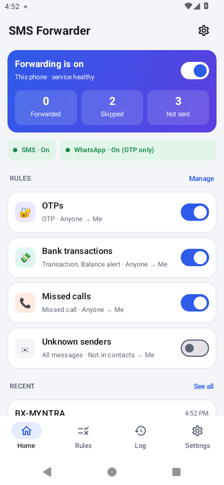
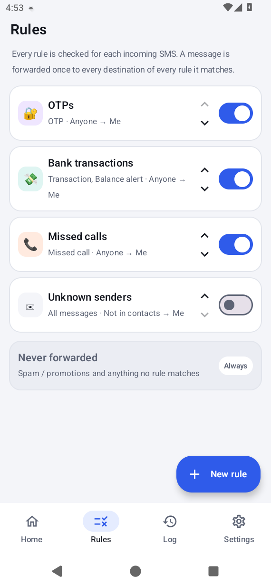
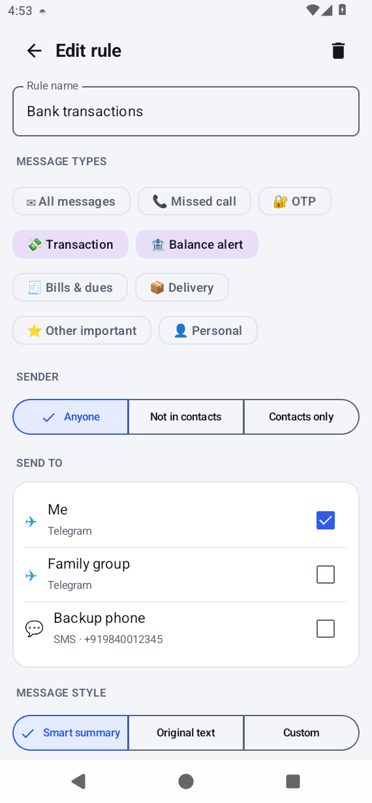
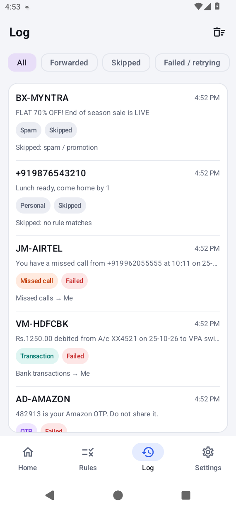
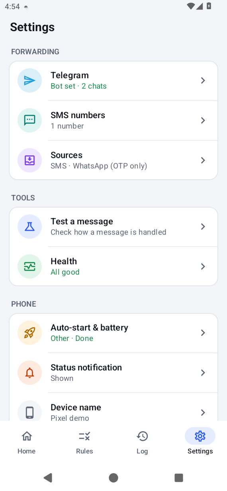
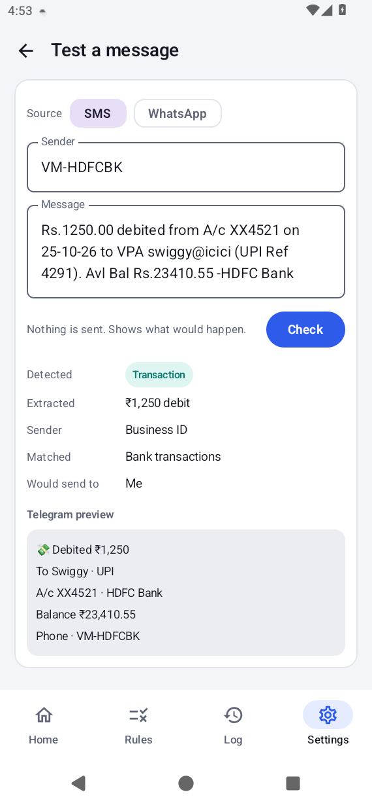
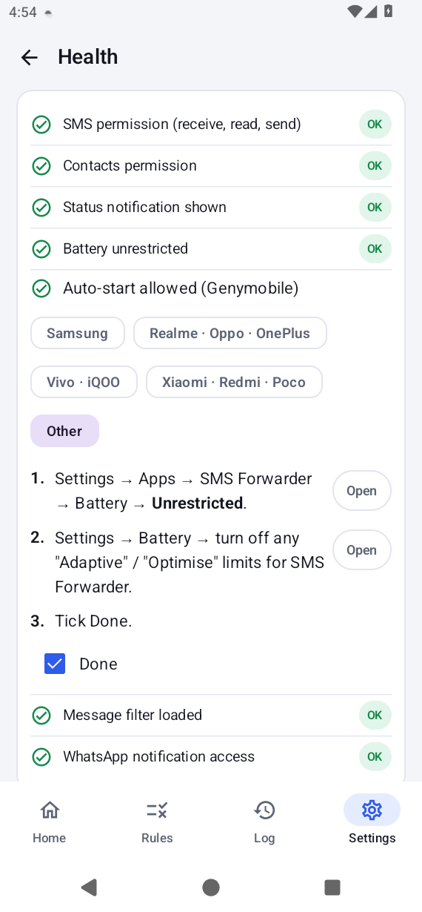
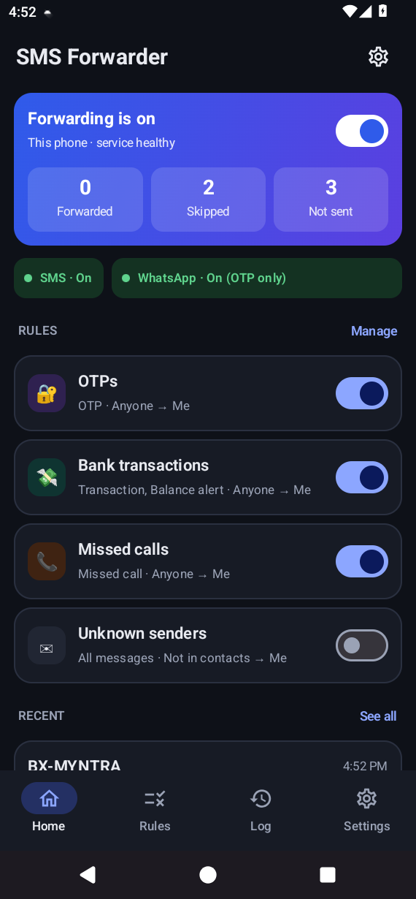

# SMS Forwarder v2

Android app (`com.viswa2k.smsforwarder`) that reads each incoming SMS, works out what it is (OTP, bank transaction, missed call, ...) and forwards it by **rules** to **Telegram chats** and/or **SMS numbers**. Built for phones that sit unattended 24x7 (for example a parent's phone) while the owner watches the messages remotely.

No cloud, no accounts, no Firebase. The app talks only to `api.telegram.org` (sending) and the GitHub releases API (update check).

## Features

- **Smart classification**: OTP, Transaction, Balance alert, Bills & dues, Delivery, Missed call, Other important, Personal. Spam, promotions and scams are never forwarded.
- **Rules**: pick message types, sender (Anyone / Not in contacts / Contacts only), destinations and a style. All matching rules are combined and each destination gets the message once. Rules can be reordered.
- **Destinations**: one Telegram bot with many chats (optional forum topic per chat, so each phone gets its own topic) and many SMS numbers (SIM choice on dual-SIM phones). Each has a Test button.
- **Message styles**: Smart (for example `OTP 482913`, `Debited ₹1,250 / To Swiggy · UPI / A/c XX4521 · HDFC Bank`), Original, or Custom with tokens `%s` sender, `%m` message, `%r` device, `%o` OTP, `%a` amount, `%t` type.
- **Delivery queue**: every send is stored and retried (30 s, doubling to 1 h) until delivered, up to 24 h, then shown as Failed. Long multi-part SMS are joined and forwarded once.
- **Log**: last 48 hours with filters, details and Resend. OTP codes are masked one hour after receipt.
- **Home**: master switch, today's Forwarded / Skipped / Not sent counts, rules, recent messages.
- **Health**: checklist for SMS, contacts, battery optimisation and OEM auto-start, each with a Fix button.
- **Telegram problem alerts** so nobody has to look at the phone (see below).
- **WhatsApp source** (optional, off by default): OTPs and bank/merchant alerts that arrive on WhatsApp are read from WhatsApp's notifications and go through the same classification, rules and destinations (see below).
- **Test a message**: paste any text and see its type, the matching rules and the exact message that would be sent.
- **Optional PIN** that locks the master switch, rules and Settings, with back-off after wrong tries.
- **Export / Import** of settings as JSON (bot token excluded unless you tick the box).
- Light and dark themes, in-app update from GitHub releases.

## How it works

```
incoming SMS -> classify -> rules -> destinations (Telegram / SMS) -> delivery queue -> Log
```

1. A manifest-registered receiver wakes the app for every SMS, even after a swipe from Recents or a reboot. Nothing polls between messages.
2. The message is classified once. A missed-call alert from the carrier wins first, then spam is dropped.
3. Every enabled rule that matches adds its destinations; the first matching rule decides the style for a destination.
4. Each (message x destination) is queued, sent right away, and retried in the background if the network or Telegram fails.
5. A foreground service, a 15-minute watchdog and a 24 h inbox catch-up scan make sure nothing is missed after a reboot or while the app process was dead. Catch-up never forwards old inbox history or messages received while forwarding was paused.

A loop guard stops an SMS from one of your own SMS destination numbers being forwarded by SMS again.

## Setup (once per phone)

1. Install the APK and open the app. The first-run checklist asks for permissions: SMS (receive/read/send) and Contacts (required), plus Notifications (optional: you can skip it).
2. **Battery**: Settings > Health > Battery > Fix, and choose **Unrestricted** (no optimisation).
3. **Auto-start / do not sleep** (Health opens the right screen where it can):
   The app shows these as numbered steps with an **Open** button each (pick your brand with the chips if detection is wrong). Settings paths:
   - **Samsung (One UI)**: (1) Settings > Apps > SMS Forwarder > Battery > Unrestricted. (2) Settings > Battery > Background usage limits > Never sleeping apps > + > add SMS Forwarder. (3) On the same screen turn off "Put unused apps to sleep" and "Auto-disable unused apps". (4) Reboot once, tick Done.
   - **Realme / Oppo / OnePlus**: (1) Settings > Apps > App management > SMS Forwarder > Battery usage > Allow auto launch + Allow background activity, Unrestricted. (2) Settings > Battery > More settings > turn off "Sleep standby optimisation" / "Optimise battery use" for the app. (3) Older phones: Phone Manager > Privacy permissions > Startup manager > allow. (4) Optional: Recent apps > long-press > Lock. Tick Done.
   - **Vivo / iQOO**: (1) Settings > Apps > SMS Forwarder > Battery > Unrestricted (or Allow background activity). (2) i Manager > App manager > Autostart manager > allow. (3) Settings > Battery > Background power consumption management > SMS Forwarder > Allow high background power consumption. (4) Tick Done.
   - **Xiaomi / Redmi / Poco**: (1) Settings > Apps > Manage apps > SMS Forwarder > Autostart on. (2) Same page > Battery saver > No restrictions. (3) Recent apps > long-press > Lock. Tick Done.
   - **Other / Google / Motorola / Nothing**: (1) Settings > Apps > SMS Forwarder > Battery > Unrestricted. (2) Settings > Battery > turn off any "Adaptive" / "Optimise" limits for the app. (3) Tick Done.
4. **Telegram**: create a bot with @BotFather and copy the token. Add the bot to your chat or group (for a forum group, add it as admin and note the topic). In Settings > Telegram paste the token, then Add chat > **Detect** (send the bot a message first) or enter the chat id (and topic id) by hand. Press Test.
5. **SMS number** (optional): Settings > SMS numbers > Add, and choose the SIM if the phone has two.
6. Review the rules on the Rules tab (OTPs, Bank transactions, Missed calls are on by default; Unknown senders is off) and attach destinations.
7. Set the **Alerts destination** and device name in Settings, optionally set a **PIN**, then tap **Start forwarding** on the last onboarding step.

8. **WhatsApp** (optional): Settings > Sources > WhatsApp on > **Allow** > in the system list pick SMS Forwarder > Allow notification access. Keep WhatsApp's notification **message previews on** and don't mute the chats that carry OTPs (a hidden preview or muted chat gives the app nothing to read).

Opening the app always restarts the service and runs the catch-up scan, so "please open the app" is a safe recovery step over the phone.

## Telegram problem alerts

Sent to the Alerts destination (default: first Telegram chat), once per problem, repeated daily while unresolved, with a "resolved" message when it clears. No heartbeat messages.

- SMS permission removed
- Contacts permission removed
- Battery optimisation turned back on
- Message classifier unavailable
- A destination failing for more than an hour (with the last error)
- Forwarding is switched off (master switch paused)
- WhatsApp notification access not allowed (only while the WhatsApp source is on)
- Phone rebooted (info)

## WhatsApp source

- **Type filter (default: OTP only)**: before any rule runs, WhatsApp messages are checked against Settings > Sources > WhatsApp > "Forward from WhatsApp:" (OTP, Transaction, Balance alert, Bills & dues, Missed call, Delivery, Other important, Personal; at least one stays selected; spam never). Everything else is logged as skipped ("WhatsApp: only OTP forwarded") and sent nowhere, whatever your rules say. SMS is not filtered. Test a message with Source = WhatsApp honours it. Export / Import carry the WhatsApp toggle and types.
- **What is read**: only notifications posted by WhatsApp (`com.whatsapp`) and WhatsApp Business (`com.whatsapp.w4b`), and only while the toggle is on. Notifications from every other app are ignored before anything in them is read; nothing from them is stored or logged.
- **Identity**: the chat name. A chat whose name equals a saved contact counts as a contact (its ordinary messages become Personal, so the default rules don't forward personal chats); others count as "not in contacts". Smart messages show "WhatsApp · Amazon"; `%s` renders "WhatsApp: Amazon". The Log marks these rows with a WhatsApp chip.
- **Limits**: only what the notification shows is forwarded (previews must be on; long messages may be cut by WhatsApp). Messages older than 10 minutes when re-shown, or from before the toggle was switched on, are never forwarded. There is no history to catch up from: a message that arrives while the listener is disconnected (app killed by the OEM, access revoked) is lost. Group chats appear as "WA:Group · Person". WhatsApp housekeeping notifications (new-message counters, backup, calls) are skipped.

## Upgrading from v1

v2 installs over v1 (same package and signing). On first launch it migrates the Telegram token and chat ids, SMS number, device alias and master switch, creates the default rules (only for channels that were enabled; "Not in contacts" if Skip Contacts was on), and deletes the old cloud settings. v1 message formats are replaced by the Smart style. The cloud inbox and Firebase features are gone in v2.

## Permissions

- `RECEIVE_SMS`, `READ_SMS`: receive messages and run the catch-up scan.
- `SEND_SMS`: forward by SMS.
- `READ_CONTACTS`: tell contacts from unknown senders for rules.
- `READ_PHONE_STATE`: SIM picker on dual-SIM phones (asked only when needed).
- `POST_NOTIFICATIONS`, `FOREGROUND_SERVICE`, `FOREGROUND_SERVICE_SPECIAL_USE`: the quiet "Forwarding SMS" notification (optional: Android needs it to keep forwarding alive, but you can hide it; to hide it use Settings > Device > Status notification > **Hide notification**, or deny the permission. Forwarding keeps working either way).
- `RECEIVE_BOOT_COMPLETED`: restart after reboot.
- `REQUEST_IGNORE_BATTERY_OPTIMIZATIONS`: ask for Unrestricted battery.
- `INTERNET`, `ACCESS_NETWORK_STATE`: Telegram and update check.
- `REQUEST_INSTALL_PACKAGES`: install updates downloaded from GitHub releases.
- Notification access (granted in system settings, not a runtime permission): only for the optional WhatsApp source.

## Troubleshooting

- **Nothing arrives in Telegram**: open Settings > Health and fix every red item; press Test on the Telegram chat. A 401 means a wrong token; "chat not found" means the bot has not been added or messaged.
- **Log says "Contacts permission missing"**: grant Contacts, or make the rule's sender "Anyone".
- **Messages stop after a while**: battery must be Unrestricted and auto-start allowed for the brand (see Setup).
- **Log says "No rule matched"**: add a rule for that type, or use the "All messages" chip.
- **Not sent tile is above zero**: those messages are retrying or failed; open the Log entry for the error and use Resend.
- **Forgot the PIN**: clear the app's data (settings are lost; export a backup beforehand).
- **Missed-call text not recognised**: paste it into Test a message and report the wording.

## Screenshots

| Home | Rules | Rule editor |
|---|---|---|
|  |  |  |

| Log | Settings | Test a message |
|---|---|---|
|  |  |  |

| Health | Home (dark) |
|---|---|
|  |  |

## Build

```bash
./gradlew testDebugUnitTest assembleDebug
./gradlew assembleRelease
```

Requires JDK 17 (Android Studio JBR), Android SDK 36.

## Changelog

### v2.0.0
- Rebuilt around rules and destinations, smart classification, delivery queue with retries, Log, Health and Telegram problem alerts, PIN, export/import.
- Removed Firebase and the cloud inbox.

### v1.1.0
- Optimized message receiver, message configuration, device alias.

## Contributing

Contributions are welcome. Open an issue or submit a pull request.

## Acknowledgments

- Jetpack Compose, Telegram Bot API.
